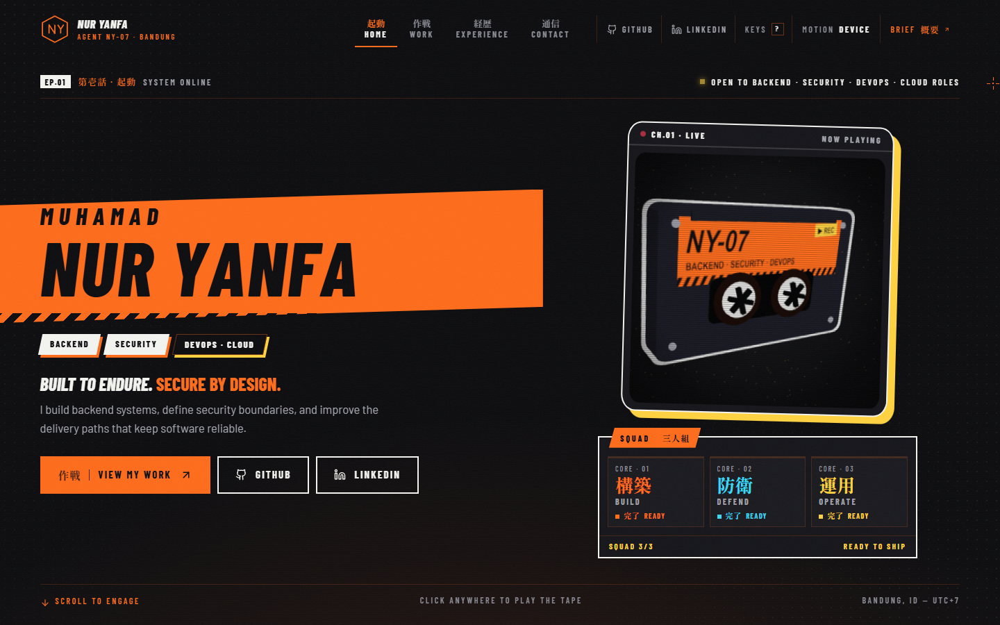
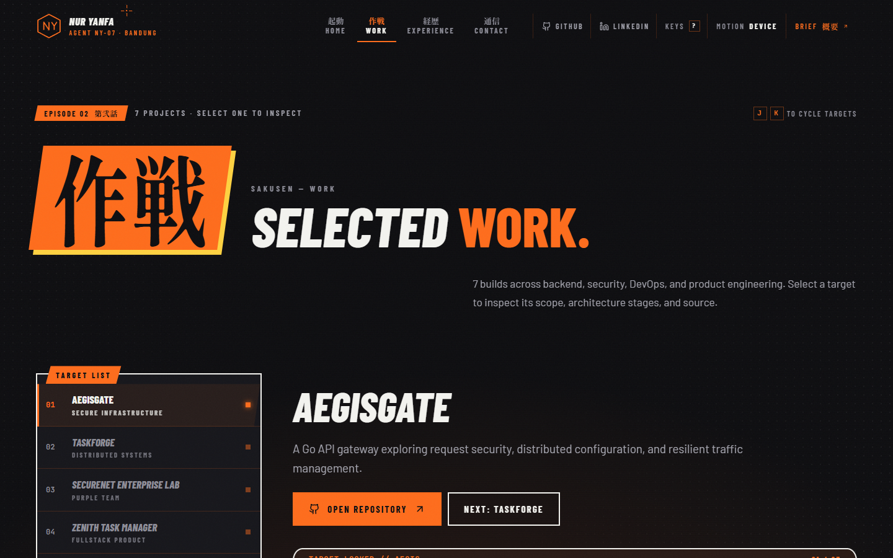
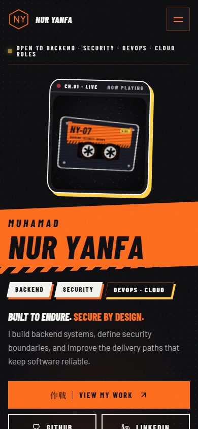

<div align="center">

# Muhamad Nur Yanfa

**Backend · Security · DevOps · Cloud**

*Built to endure. Secure by design.*

I build backend systems, define security boundaries, and improve the delivery paths that keep software reliable. Based in Bandung, Indonesia, open to backend, security, DevOps, and cloud roles.

[Live portfolio](https://nuryanfa.vercel.app/) · [One-page overview](https://nuryanfa.vercel.app/overview) · [Selected work](https://nuryanfa.vercel.app/archive) · [Contact](https://nuryanfa.vercel.app/network)

</div>

---

[](https://nuryanfa.vercel.app/)

<details>
<summary>More screens: the work archive and the mobile home</summary>

<br />





</details>

## Start here

| If you have | Go to |
| --- | --- |
| 30 seconds | [One-page overview](https://nuryanfa.vercel.app/overview): roles, projects, experience and credentials, printable as a PDF |
| 2 minutes | [Selected work](https://nuryanfa.vercel.app/archive): each project's scope, status, architecture stages and source |
| Code to read | [AegisGate](https://github.com/Nuryanfa/AegisGate), the Go API gateway behind most of the backend and security claims |

## Selected work

Statuses are labelled honestly on the site and repeated here.

| Project | Focus | Status |
| --- | --- | --- |
| [AegisGate](https://github.com/Nuryanfa/AegisGate) | Go API gateway: request security, Redis-backed rate limits, bounded WAF checks, observability, gRPC control plane | v0.8 released; production-like, not production-ready |
| [TaskForge](https://github.com/Nuryanfa/TaskForge) | Durable background jobs and workflow orchestration in Go | v0.1 foundation; workers and database-backed execution are planned |
| [SecureNet Enterprise Lab](https://github.com/Nuryanfa/securenet-enterprise-lab) | Network segmentation, detection with Wazuh and Suricata, MITRE ATT&CK mapping | Deployed lab |
| [Zenith Task Manager](https://github.com/Nuryanfa/TaskManager) | MERN task management with Kanban planning and focus sessions | Repository |
| [Smart Sprint Training System](https://github.com/Nuryanfa/DeteksiPose-Lari) | Markerless pose estimation and athlete session analysis | In development |
| Certificate Validation System | X.509 validation architecture with explicit trust boundaries | Prototype; no dedicated repository |
| [E-Commerce SQA](https://github.com/Nuryanfa/e-commerse-sqa) | Critical commerce flows and repeatable quality workflows | Archived |

The three-stage architecture maps on the site explain each project's design; they are not live telemetry. Follow the source links for implementation detail.

## Experience

- **DevOps Engineer, Nuansa Teknologi Indonesia (current):** production servers and hosting, the team's code workflow, and CI/CD pipelines.
- **Fullstack Developer, Universitas Kebangsaan (SI MANTAP):** university application features and student guidance workflows.
- **Backend Engineer Intern, Digitak Labs:** API development, relational data design, and GitLab delivery workflows.

**Credentials:** 23 Google Cloud skill badges on [Google Skills](https://www.skills.google/public_profiles/7e1b2448-d30c-499f-a889-034966a54a1b), covering networking and IAM, compute and serverless delivery, and data platforms.

## About this site

The portfolio is framed as an anime series: every page is an episode with its own title card, and the interface borrows from Zenless Zone Zero and Persona (slanted panels, sticker labels, CRT screens and VHS tapes) over a warm orange and graphite palette.

- **Motion with a purpose.** Pages change like a TV channel: the screen closes to a line, the episode card appears, and the next page opens. The new page renders while the screen is dark, so the switch stays smooth on heavy pages.
- **A cel-shaded 3D tape** plays on the home screen (three.js, toon shading with an inverted-hull outline). It loads after the page is idle, pauses off-screen, and falls back to CSS on weak devices.
- **Readable first.** Project title, summary and repository link come before decoration; every page name matches the navigation.
- **Accessible by default.** Reduced motion is respected (Device, Full and Reduced modes), touch targets are at least 44px, headings are ordered, and the archive works by keyboard (arrow keys, Home, End, and J/K).
- **Extras.** Number keys switch pages, `?` opens the keyboard map, `` ` `` opens a small terminal, and there is a hidden drill to find.

## Stack

| Layer | Technology |
| --- | --- |
| Interface | React 18 · React Router 7 |
| Build | Vite 5, plus a prerender step that writes per-route HTML with Open Graph tags |
| Motion | GSAP 3 (ScrollTrigger, SplitText) · Lenis smooth scroll |
| 3D | three.js · React Three Fiber |
| Styling | Hand-written CSS with design tokens |
| Icons and type | Lucide · Barlow Condensed · Barlow · JetBrains Mono · Shippori Mincho (kanji) |
| Hosting | Vercel · Vercel Analytics · Speed Insights |

## Run locally

Use Node.js 22 or newer.

```bash
git clone https://github.com/Nuryanfa/webporto-security.git
cd webporto-security
npm ci
npm run dev
```

Open the URL Vite prints, usually `http://localhost:5173`. The site needs no secrets or database.

| Command | Purpose |
| --- | --- |
| `npm run dev` | Start the development server |
| `npm run build` | Build to `dist/` and prerender each route |
| `npm run preview` | Serve the production build locally |
| `npm run test:smoke` | Render every page and project deep link, and check the content stays consistent |

The smoke test checks rendering and data; motion, keyboard and mobile layouts still need a check in the browser.

## Editing content

Everything you would want to change lives in `src/content/`: profile, projects, experience, capabilities, credentials, page episodes and SEO. See [the development guide](docs/DEVELOPMENT.md) for the source layout, editing rules, verification and deployment.

## Contact

[GitHub](https://github.com/Nuryanfa) · [LinkedIn](https://www.linkedin.com/in/muhamad-nur-yanfa-069036368) · [Email, via the contact page](https://nuryanfa.vercel.app/network)
